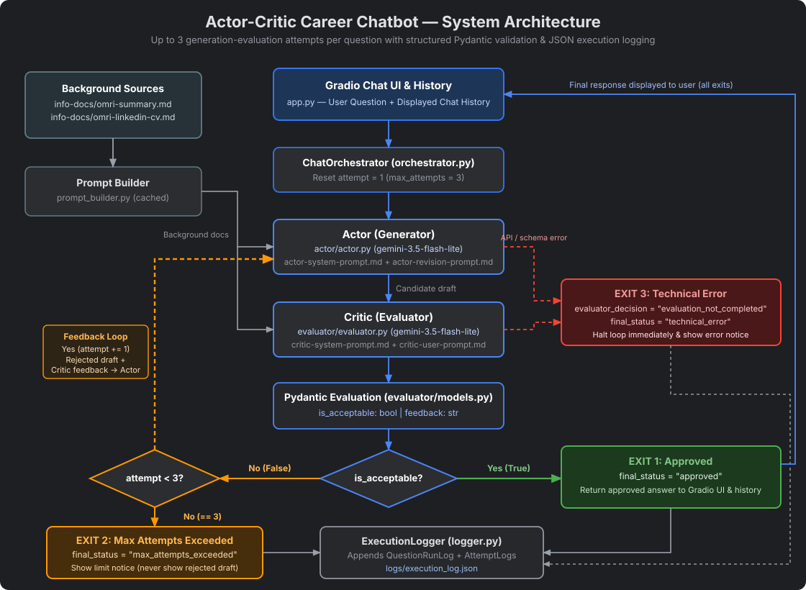
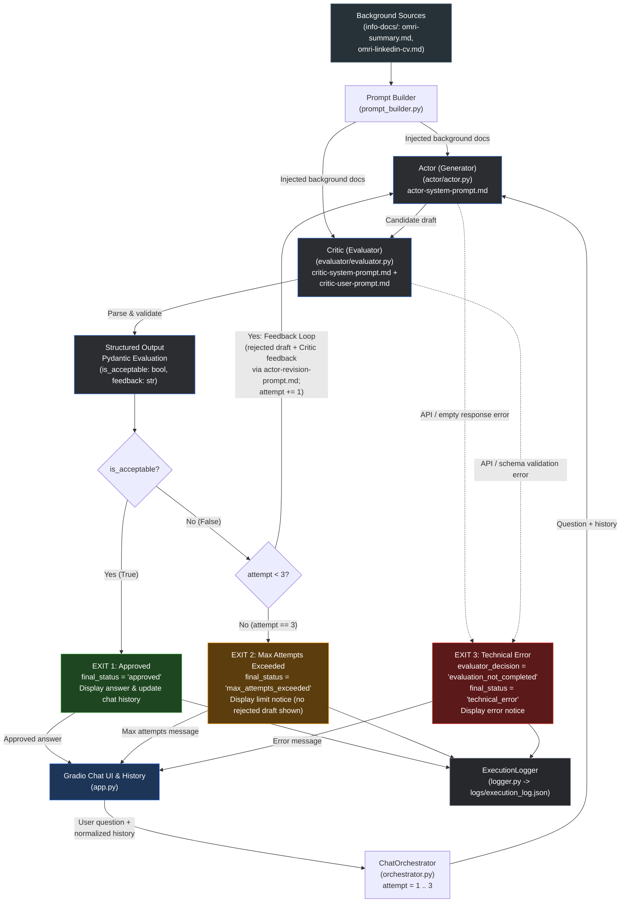

# System Architecture — Actor-Critic Career Chatbot

This diagram illustrates the end-to-end execution flow of the Actor-Critic chatbot (`app.py`, `orchestrator.py`, `actor/`, `evaluator/`, `prompt_builder.py`, and `logger.py`), including the background sources, conversation history, structured `Evaluation` output, the feedback revision loop, and all three exit paths (**Approved**, **Max Attempts Exceeded**, and **Technical Error**).

## Rendered Diagram (Static SVG)

## Mermaid Source

